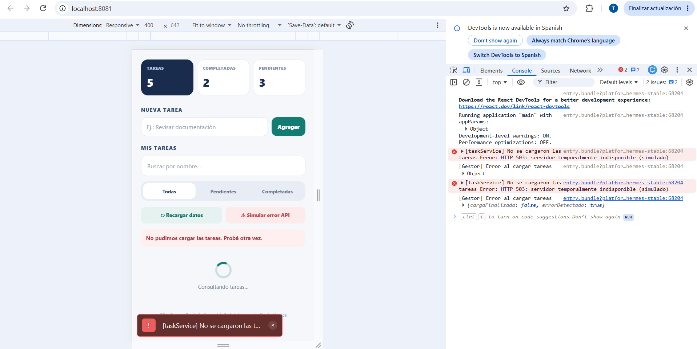
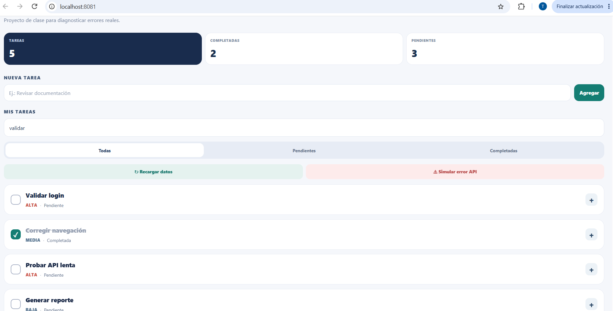
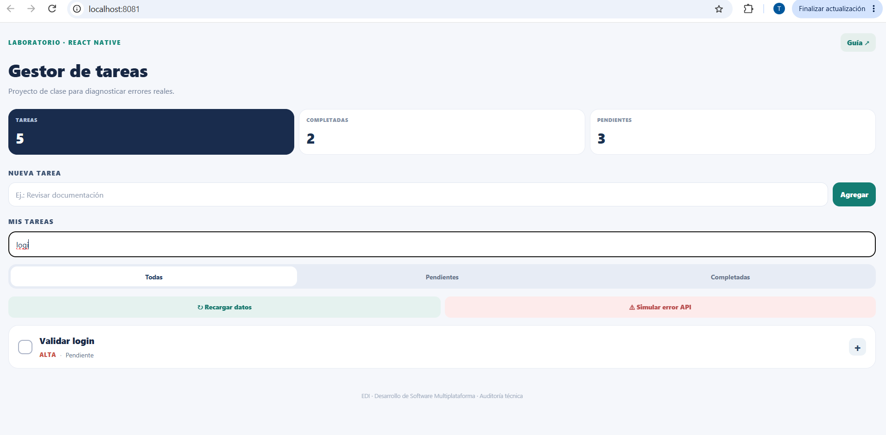
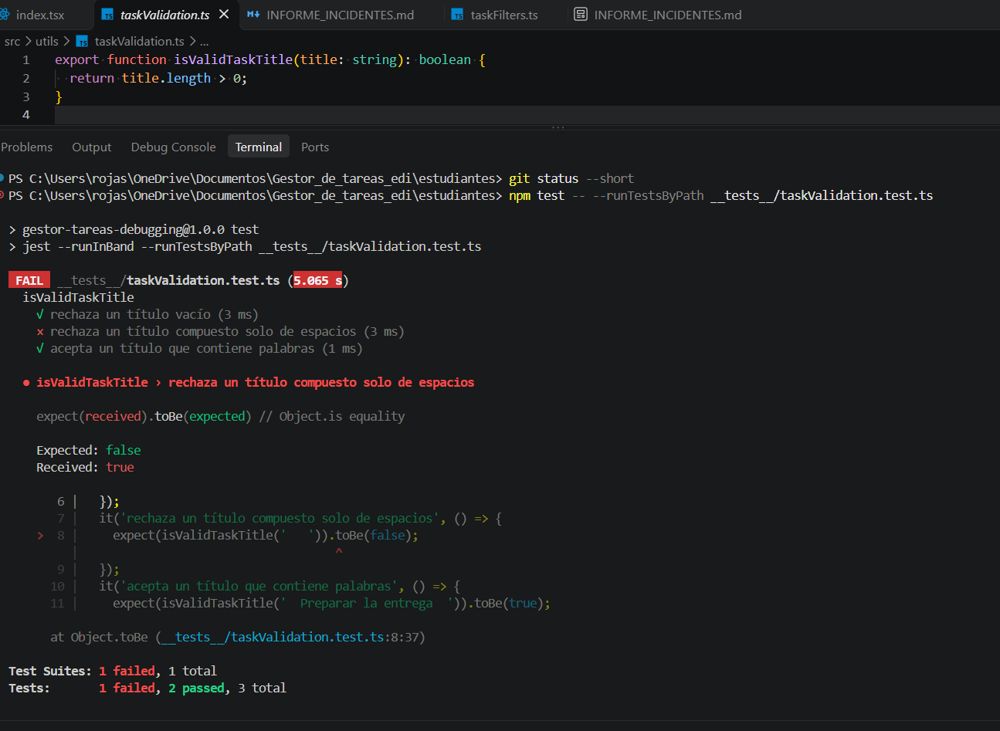
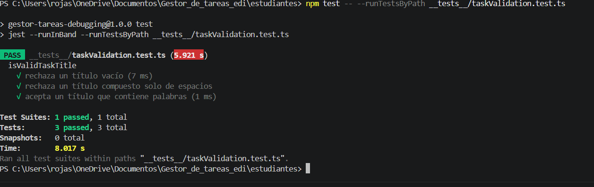

# Informe de incidencias · Gestor de tareas

**Estudiante:** Tiago Rojas
**Fecha:** 18/11/2026
**Proyecto / rama Git:** `rojastiago/gestor-tareas-edi` / `main`
**Entorno (Expo SDK, Android, dispositivo):** Expo SDK 57. Probé en Chrome desde una PC con Windows. No usé Android en estas pruebas.

## Resumen ejecutivo

Probé en el tablero qué pasaba al completar una tarea y al simular un error del servicio. También ejecuté `npm test` y revisé las fallas de búsqueda y validación. Registré cuatro incidencias: dos observadas en Chrome y dos detectadas con Jest. Las cuatro están pendientes de corrección.

## Incidencia 1
- **Título de incidencia:** El tilde aparece después de cambiar de pestaña.
- **Pasos para reproducir:** Abrir el tablero, marcar la tarea "Validar login", cambiar a Pendientes y después volver a Todas. Luego actualizar la página.
- **Esperado / observado:** Esperaba que el tilde apareciera al hacer clic, pero no apareció. Cuando cambié de pestaña y volví, recién apareció marcado. Después actualicé la página y el tilde desapareció.
- **Herramienta usada (DevTools / consola / test):** Prueba manual en Chrome.
- **Hipótesis y evidencia:** Puede ser un problema con la actualización de la tarea, porque el cambio se muestra recién al pasar de una pestaña a otra. También observé que, al actualizar la página, la tarea vuelve a su estado inicial.
**Evidencia del log:**

- **Archivo y función involucrada:** `app/index.tsx`, función `toggleTask`.
- **Causa raíz:** La función modificaba directamente el estado de la tarea y después usaba `setTasks(tasks)` con el mismo arreglo. Por eso React no actualizaba la pantalla inmediatamente.
- **Corrección aplicada:** Cambié la función para utilizar `setTasks` con `map()`, creando un nuevo arreglo y una copia de la tarea modificada.
- **Prueba de regresión:** Volví a marcar una tarea en Chrome y comprobé que el tilde aparece inmediatamente, sin cambiar de pestaña.
- **Estado:** Corregido.

## Incidencia 2
- **Título de incidencia:** La carga no terminaba después de simular un error del servicio.
- **Pasos para reproducir:** Abrí el tablero y presioné «Simular error API». Después de corregir el código, volví a realizar la misma prueba y también presioné «Recargar datos».
- **Esperado / observado:** Esperaba que apareciera el mensaje de error y terminara la carga. Antes de la corrección, aparecía el error, pero seguía mostrando «Consultando tareas». Después del cambio, el mensaje apareció y la carga terminó correctamente.
- **Herramienta usada (DevTools / consola / test):** Prueba manual en Chrome y consola de desarrollador.
- **Hipótesis y evidencia:** Sospeché que la carga no se desactivaba cuando fallaba la consulta. En la consola apareció el error HTTP 503 simulado y el log que agregué. También se veía el indicador de carga junto con el mensaje de error.
- **Archivo y función involucrada:** `app/index.tsx`, función `loadTasks`.
- **Causa raíz:** El `setLoading(false)` estaba dentro del bloque `try`, por lo que solamente se ejecutaba cuando la consulta salía bien. Si ocurría un error, el programa pasaba al `catch` y la carga quedaba activa.
- **Corrección aplicada:** Moví `setLoading(false)` a un bloque `finally` para que la carga termine tanto cuando la consulta funciona como cuando falla.
- **Prueba de regresión:** Volví a simular el error y comprobé que desaparece «Consultando tareas» y aparece el mensaje de error. Después presioné «Recargar datos» y volvieron a mostrarse las cinco tareas.
- **Estado:** Corregido.

**Evidencia del error:**

## Incidencia 3
- **Título de incidencia:** La búsqueda no encontraba correctamente las tareas.
- **Pasos para reproducir:** Abrí el gestor y escribí "validar" en el buscador. La lista seguía mostrando todas las tareas. También probé búsquedas con mayúsculas y espacios.
- **Esperado / observado:** Esperaba que apareciera solamente la tarea "Validar login". Antes no se filtraba correctamente la lista. Después de las correcciones, las búsquedas funcionan.
- **Herramienta usada (DevTools / consola / test):** Pruebas manuales en Chrome y pruebas automatizadas con Jest.
- **Hipótesis y evidencia:** Primero observé que el filtro no encontraba textos con mayúsculas o espacios. Después comprobé que, aunque las pruebas de Jest pasaban, la pantalla no actualizaba los resultados mientras escribía.
- **Archivo y función involucrada:** `src/utils/taskFilters.ts`, función `filterTasks`, y `app/index.tsx`, cálculo de `visibleTasks` con `useMemo`.
- **Causa raíz:** La función de búsqueda utilizaba `includes()` sin normalizar el texto. Además, faltaba `query` en las dependencias de `useMemo`, por lo que la lista no se actualizaba cuando cambiaba la búsqueda.
- **Corrección aplicada:** Utilicé `trim()` y `toLowerCase()` para normalizar el texto. También agregué `query` a las dependencias de `useMemo`.
- **Prueba de regresión:** Ejecuté las cuatro pruebas de `taskFilters.test.ts` y todas pasaron. Después comprobé en Chrome que el buscador filtra las tareas correctamente.
- **Estado:** Corregido.

**Evidencia antes de la corrección:**

**Evidencia después de la corrección:**

## Incidencia 4
- **Título de incidencia:** El formulario permitía ingresar tareas con títulos compuestos solamente por espacios.
- **Pasos para reproducir:** Abrí el gestor, escribí tres espacios en el campo "Nueva tarea" y presioné "Agregar". También ejecuté las pruebas de validación con Jest.
- **Esperado / observado:** Esperaba que el sistema rechazara los títulos que solamente contenían espacios. Antes de la corrección, la validación los aceptaba. Después del cambio, el formulario los rechaza correctamente.
- **Herramienta usada (DevTools / consola / test):** Pruebas automatizadas con Jest y pruebas manuales en Chrome.
- **Hipótesis y evidencia:** La función comprobaba únicamente que el título tuviera una longitud mayor que cero. En Jest, la prueba de títulos con espacios fallaba porque devolvía true cuando esperaba false.
- **Archivo y función involucrada:** `src/utils/taskValidation.ts`, función `isValidTaskTitle`.
- **Causa raíz:** Se utilizaba `title.length > 0`, que considera válidos los espacios porque también son caracteres.
- **Corrección aplicada:** Agregué `trim()` antes de comprobar la longitud del título, para eliminar los espacios al principio y al final.
- **Prueba de regresión:** Ejecuté nuevamente las pruebas de validación y las tres pasaron. También comprobé en Chrome que no se puede agregar una tarea con solamente espacios, pero sí una con un título válido.
- **Estado:** Corregido.

**Evidencia antes de la corrección:**

**Evidencia después de la corrección:**

## Otras incidencias (opcional)

## Pruebas

En la primera ejecución de `npm test` pasaron 6 pruebas y fallaron 3.

| Prueba | Antes | Después | Evidencia |
|---|---|---|---|
| Búsqueda | No encontraba tareas con mayúsculas ni espacios y no actualizaba la lista | Las 4 pruebas de Jest pasaron y el buscador funciona correctamente en Chrome | Resultado de Jest y capturas antes y después |
| Validación | Aceptaba títulos compuestos únicamente por espacios | Las 3 pruebas de Jest pasaron y el formulario rechaza esos títulos en Chrome | Capturas de Jest antes y después y prueba manual en Chrome |
| Actualización de estado | El tilde apareció al cambiar de pestaña y volver | Pendiente | Observación manual en Chrome |
| Error de servicio | El mensaje de carga seguía visible después del error | El indicador desaparece y permite recargar las cinco tareas | Captura de consola y prueba manual en Chrome |

## Conclusión y control de cambios

- **Commit final (hash):** Pendiente de generar.
- **Mensaje del commit:** fix: corregir validacion de titulos y finalizar informe de incidencias
- **Qué aprendí y cómo lo aplicaría a mi app final:** Con este trabajo aprendí a encontrar errores utilizando la consola, las pruebas automatizadas y las herramientas de desarrollo del navegador. También comprendí la importancia de actualizar correctamente el estado en React, manejar los errores de servicios, revisar las dependencias de useMemo y validar los datos antes de guardarlos. En mi aplicación final utilizaría estas herramientas para detectar problemas y comprobar que las correcciones no afecten otras funciones.

Al finalizar las cuatro correcciones, ejecuté npm test y las 9 pruebas del proyecto pasaron correctamente.
