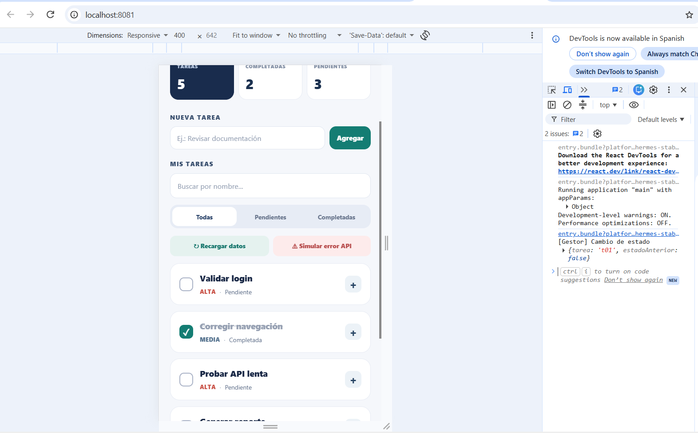

# Informe de incidencias · Gestor de tareas

**Estudiante:** Tiago Rojas
**Fecha:** 18/11/2026
**Proyecto / rama Git:** `rojastiago/gestor-tareas-edi` / `main`
**Entorno (Expo SDK, Android, dispositivo):** Expo SDK 57. Probé en Chrome desde una PC con Windows. No usé Android en estas pruebas.

## Resumen ejecutivo

Probé en el tablero qué pasaba al completar una tarea y al simular un error del servicio. También ejecuté `npm test` y revisé las fallas de búsqueda y validación. Registré cuatro incidencias: dos observadas en Chrome y dos detectadas con Jest. Las cuatro están pendientes de corrección.

## Incidencia 1
- **Título de incidencia:** El tilde aparece después de cambiar de pestaña.
- **Pasos para reproducir:** Abrir el tablero, marcar la tarea "Validar login", cambiar a Pendientes y después volver a Todas. Luego actualizar la página.
- **Esperado / observado:** Esperaba que el tilde apareciera al hacer clic, pero no apareció. Cuando cambié de pestaña y volví, recién apareció marcado. Después actualicé la página y el tilde desapareció.
- **Herramienta usada (DevTools / consola / test):** Prueba manual en Chrome.
- **Hipótesis y evidencia:** Puede ser un problema con la actualización de la tarea, porque el cambio se muestra recién al pasar de una pestaña a otra. También observé que, al actualizar la página, la tarea vuelve a su estado inicial.
**Evidencia del log:**

- **Archivo y función involucrada:** `app/index.tsx`, función `toggleTask`.
- **Causa raíz:** La función modificaba directamente el estado de la tarea y después usaba `setTasks(tasks)` con el mismo arreglo. Por eso React no actualizaba la pantalla inmediatamente.
- **Corrección aplicada:** Cambié la función para utilizar `setTasks` con `map()`, creando un nuevo arreglo y una copia de la tarea modificada.
- **Prueba de regresión:** Volví a marcar una tarea en Chrome y comprobé que el tilde aparece inmediatamente, sin cambiar de pestaña.
- **Estado:** Corregido.

## Incidencia 2
- **Título de incidencia:** La carga no terminaba después de simular un error del servicio.
- **Pasos para reproducir:** Abrí el tablero y presioné «Simular error API». Después de corregir el código, volví a realizar la misma prueba y también presioné «Recargar datos».
- **Esperado / observado:** Esperaba que apareciera el mensaje de error y terminara la carga. Antes de la corrección, aparecía el error, pero seguía mostrando «Consultando tareas». Después del cambio, el mensaje apareció y la carga terminó correctamente.
- **Herramienta usada (DevTools / consola / test):** Prueba manual en Chrome y consola de desarrollador.
- **Hipótesis y evidencia:** Sospeché que la carga no se desactivaba cuando fallaba la consulta. En la consola apareció el error HTTP 503 simulado y el log que agregué. También se veía el indicador de carga junto con el mensaje de error.
- **Archivo y función involucrada:** `app/index.tsx`, función `loadTasks`.
- **Causa raíz:** El `setLoading(false)` estaba dentro del bloque `try`, por lo que solamente se ejecutaba cuando la consulta salía bien. Si ocurría un error, el programa pasaba al `catch` y la carga quedaba activa.
- **Corrección aplicada:** Moví `setLoading(false)` a un bloque `finally` para que la carga termine tanto cuando la consulta funciona como cuando falla.
- **Prueba de regresión:** Volví a simular el error y comprobé que desaparece «Consultando tareas» y aparece el mensaje de error. Después presioné «Recargar datos» y volvieron a mostrarse las cinco tareas.
- **Estado:** Corregido.

**Evidencia del error:**

## Incidencia 3
- **Título de incidencia:** La búsqueda falla con mayúsculas y espacios externos.
- **Pasos para reproducir:** Ejecutar `npm test` y revisar las pruebas de búsqueda de `__tests__/taskFilters.test.ts`.
- **Esperado / observado:** Las pruebas esperaban encontrar una tarea al buscar `VALIDAR` y al buscar `login` con dos espacios antes y después. En los dos casos se obtuvo una lista vacía.
- **Herramienta usada (DevTools / consola / test):** Jest.
- **Hipótesis y evidencia:** La búsqueda podría estar comparando el texto tal como se escribe. Fallaron las pruebas que usaron mayúsculas y espacios externos.
- **Archivo y función involucrada:** `src/utils/taskFilters.ts`, función `filterTasks`.
- **Causa raíz:** Pendiente de confirmar.
- **Corrección aplicada:** Pendiente.
- **Prueba de regresión:** Volver a ejecutar las dos pruebas y comprobar que cada búsqueda encuentre la tarea esperada.
- **Estado:** Pendiente.

## Incidencia 4
- **Título de incidencia:** La validación acepta un título compuesto solo por espacios.
- **Pasos para reproducir:** Ejecutar `npm test` y revisar la prueba de `__tests__/taskValidation.test.ts` que usa un título de tres espacios.
- **Esperado / observado:** La función debía devolver `false` para rechazar el título. Devolvió `true` y lo tomó como válido.
- **Herramienta usada (DevTools / consola / test):** Jest.
- **Hipótesis y evidencia:** La validación podría estar contando los espacios como contenido. La prueba mostró que tres espacios fueron suficientes para que devolviera `true`.
- **Archivo y función involucrada:** `src/utils/taskValidation.ts`, función `isValidTaskTitle`.
- **Causa raíz:** Pendiente de confirmar.
- **Corrección aplicada:** Pendiente.
- **Prueba de regresión:** Comprobar que la función rechace un título de tres espacios y siga aceptando un título con palabras.
- **Estado:** Pendiente.

## Otras incidencias (opcional)

## Pruebas

En la primera ejecución de `npm test` pasaron 6 pruebas y fallaron 3.

| Prueba | Antes | Después | Evidencia |
|---|---|---|---|
| Búsqueda | Las dos búsquedas devolvieron una lista vacía | Pendiente | Salida inicial de Jest |
| Validación | La función aceptó un título de tres espacios | Pendiente | Salida inicial de Jest |
| Actualización de estado | El tilde apareció al cambiar de pestaña y volver | Pendiente | Observación manual en Chrome |
| Error de servicio | El mensaje de carga seguía visible después del error | El indicador desaparece y permite recargar las cinco tareas | Captura de consola y prueba manual en Chrome |

## Conclusión y control de cambios
- **Commit final (hash):** Pendiente.
- **Mensaje del commit:** Pendiente.
- **Qué aprendí y cómo lo aplicaría a mi app final:** Pendiente de completar después de revisar el código y comprobar las correcciones.